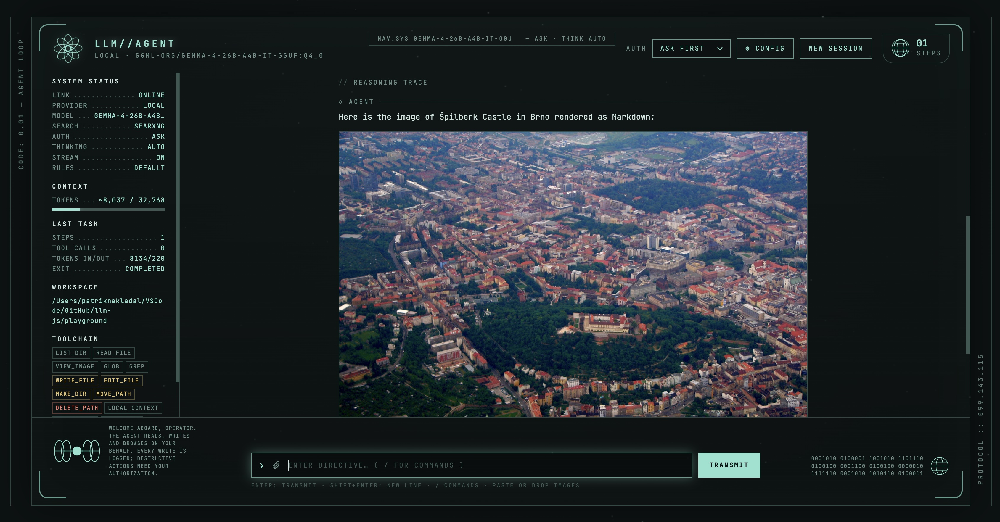

# llm-agent

An agent loop in TypeScript with filesystem tools, web search and web fetch. It works with local models (llama.cpp, Ollama, LM Studio, vLLM), OpenAI, Anthropic, or any OpenAI-compatible endpoint, and you can drive it from a terminal or from a browser UI.

Node runs the TypeScript directly (≥ 22.18, no build step), or you can run the whole stack in Docker.



## Quick start

**Docker (everything included):**

```bash
cp .env.example .env              # optional: API keys, LLM URL
docker compose up -d --build      # agent UI + SearXNG search
open http://127.0.0.1:8787
```

**Local Node:**

```bash
make setup                        # npm ci, .env, health check
make search-up                    # SearXNG in Docker (optional but recommended)
make start                        # UI on http://127.0.0.1:8787 in the background, workspace ./playground
make cli                          # terminal chat
node src/cli.ts -w ./playground "Summarise every markdown file into SUMMARY.md"
```

Click **⚙ Config** (or the model name) in the UI to choose a provider and model. The choice is saved and reused by the CLI too.

## Make targets

Run `make` to list everything. These are the common ones:

| Command | What it does |
|---|---|
| `make setup` | `npm ci`, create `.env` from the example, run `doctor` |
| `make doctor` | Check Node ≥ 22.18, dependencies, the LLM endpoint, search, the port and Docker |
| `make start` / `stop` / `restart` / `status` / `logs` | Run the web UI in the background (PID and log in `.run/`), wait until healthy, show provider/model |
| `make dev` | Foreground server that restarts when `src/` or `web/` change |
| `make cli`, `make run TASK="…"` | Terminal chat, or a one-shot task |
| `make check` | The CI gate: Biome lint + format check, `tsc`, tests |
| `make fix` | Apply formatting, import sorting and safe lint fixes |
| `make coverage`, `make audit` | Coverage report; audit of production dependencies |
| `make docker-up` / `docker-down` / `docker-logs` | The full Docker stack |
| `make search-up` | Only SearXNG, for running the agent with Node |
| `make agent-up NAME=alpha` / `agent-down` / `agents` / `agent-logs` / `agent-shell` | Isolated agents, each in its own hardened container with its own workspace |

Every setting can be overridden: `make start PORT=8800 WORKSPACE=~/code/project MODE=auto-edit MODEL=…`. It works with macOS's GNU Make 3.81. The npm scripts (`npm run check`, `npm run lint`, …) mirror the main targets.

Linting and formatting use [Biome](https://biomejs.dev) ([biome.json](biome.json)). `noExplicitAny` and `noNonNullAssertion` are off on purpose: `any` appears only at untyped SDK/JSON/`catch` boundaries, and `tsc --strict` covers the rest.

## Providers and models

| Provider | How it connects | Key |
|---|---|---|
| **Local** | OpenAI-compatible `/v1` (default `http://localhost:9931/v1`, or `LLM_BASE_URL`) | optional |
| **OpenAI** | `https://api.openai.com/v1`, chat models only in the list | `OPENAI_API_KEY` or typed in the UI |
| **Anthropic** | Native Messages API via `@anthropic-ai/sdk`, with a streaming adapter | `ANTHROPIC_API_KEY` or typed in the UI |
| **Custom** | Any OpenAI-compatible URL (OpenRouter, Groq, Together, a remote Ollama…) | optional |

**Scan models** lists what the provider offers. For Anthropic it also fills in each model's context window.

Settings are stored in `~/.llm-agent/settings.json` (mode 0600, override with `AGENT_CONFIG_DIR`; in Docker, the `agent-config` volume). They are never stored in the repository. Keys from `.env` are used but not copied into that file, and the browser only ever sees a `••••last4` hint.

Precedence: CLI flags (`-m`, `-u`, `-k`) > settings saved in the UI > `.env` / defaults.

Switching provider mid-conversation keeps the conversation. The transcript is stored in one format, and each adapter translates it per request.

## How it works

```
user message
   └─► model (streamed) ──► text?  ───────────────► done (RunResult)
              │
              └─► tool calls ─► validate ─► policy ─► approve? ─► run ─► results ─┐
                     ▲                                                              │
                     └──────────────────────────────────────────────────────────────┘
```

### Contracts

| Contract | Where | Guarantees |
|---|---|---|
| `ChatClient` | [src/providers.ts](src/providers.ts) | `streamChat()` takes OpenAI-shaped requests and returns OpenAI-shaped chunks. `listModels()` returns `{ id, label?, contextTokens? }`. The Anthropic adapter maps system/tool_use/tool_result, keeps roles alternating, and sanitises tool ids. |
| `Tool` | [src/tools/types.ts](src/tools/types.ts) | snake_case name, JSON-Schema `parameters`, a `risk` (`read` / `write` / `destructive`). Side-effecting tools implement `describe()`, which validates and previews without changing anything. Recoverable failures are thrown as `ToolError`. |
| `Agent.run()` | [src/agent.ts](src/agent.ts) | Returns a `RunResult` `{ text, stopReason, steps, toolCalls, usage }`. It never throws for tool errors, bad arguments, denials or cancellation. The transcript always stays valid to resend. |
| `PermissionPolicy` | | `read-only`, `ask`, `auto-edit` (writes run, deletes ask), `auto`, plus `allow` / `deny` tool lists |

### Rules the harness enforces in code

1. Arguments are parsed leniently, coerced (`"5"` → `5`), and validated against the schema. Errors go back to the model so it can fix them.
2. No write or destructive tool runs unless the policy allows it. In `ask` mode the human sees a summary and preview first.
3. Filesystem tools are confined to the workspace, including symlink escapes.
4. `web_fetch` refuses localhost and private IPs, checked on every redirect (`AGENT_ALLOW_PRIVATE_FETCH=1` lifts this).
5. The same call repeated more than 3 times is blocked as a loop. There's a per-tool timeout, a result-size cap, and a step limit.
6. Context management: the agent learns chars-per-token from usage reports, shrinks old tool output, drops old turns, and retries after an overflow error.
7. Web and file content is treated as data, never instructions. `AGENTS.md` in the workspace is added as project rules.

### Tools

| Tool | Risk | |
|---|---|---|
| `list_dir`, `read_file` | read | explore files; line-numbered reads with ranges |
| `glob` | read | find files by pattern (`*.ts` matches at any depth), newest first, honours `.gitignore` |
| `grep` | read | regex search with context lines and `content` / `files` / `count` modes. Uses ripgrep when installed, an identical built-in search otherwise |
| `local_context` | read | live local date/time and time zone, OS, CPU, memory, shell, installed CLI tools, workspace git branch / last commit / remote and project scripts |
| `run_command` | execute | shell commands in the workspace (see [Running commands safely](#running-commands-safely)) |
| `view_image` | read | look at a PNG/JPEG/GIF/WebP in the workspace (vision models) |
| `write_file`, `edit_file`, `make_dir`, `move_path` | write | `edit_file` needs an exact, unique snippet |
| `delete_path` | destructive | asks unless the mode is `auto` |
| `web_search` | read | Tavily → Brave → SearXNG → DuckDuckGo, whichever is configured first |
| `web_fetch` | read | HTML → readable Markdown, JSON pretty-printed, paginated |

**Search:** `npm run search:up` starts SearXNG on `127.0.0.1:8888` (config in [searxng/settings.yml](searxng/settings.yml)), and `.env.example` already points `SEARXNG_URL` at it. Keyless DuckDuckGo often answers scripts with a bot challenge, so prefer SearXNG or a Brave or Tavily key.

## Docker

[docker-compose.yml](docker-compose.yml) runs two services:

- **agent**: built from the [Dockerfile](Dockerfile) (`node:24-alpine`, runs as a non-root user, has a healthcheck). Published on `127.0.0.1:${AGENT_PORT:-8787}`. Your workspace is mounted at `/workspace` (`AGENT_WORKSPACE`, default `./playground`). Settings live in the `agent-config` volume.
- **searxng**: pinned image, published on `127.0.0.1:8888`, reached by the agent as `http://searxng:8080`.

The LLM stays outside the stack. Inside the container `localhost` is the container itself, so the agent reaches your host's model server via `http://host.docker.internal:9931/v1` (override with `DOCKER_LLM_BASE_URL`). OpenAI and Anthropic need nothing extra.

```bash
npm run docker:up        # build + start
npm run docker:logs
npm run docker:down
AGENT_WORKSPACE=~/code/my-project AGENT_PORT=8800 docker compose up -d
```

On Linux, the container user (uid 1000) needs write access to the mounted workspace.

### Where does it run? Local vs container, and many agents

- **`make start`, `make dev`, `npm start`:** the agent is a Node process on your machine. Its workspace is a folder on your disk (`WORKSPACE`, default `./playground`), and `run_command` runs **as your user on your machine**.
- **`make docker-up`:** the agent runs in a container, with `./playground` mounted at `/workspace`. Commands run **inside the container**: they see only `/workspace` and the container, not the rest of your machine.
- **`make agent-up NAME=…`:** as many isolated agents as you want. Each gets:
  - its own container `llm-agent-<name>`;
  - its own workspace `workspaces/<name>` → `/workspace` (or `AGENT_WS=<dir>`);
  - its own settings volume (provider, model, keys);
  - its own port (a free one is picked unless you pass `AGENT_PORT`).

  Agents share one SearXNG but nothing else: separate workspaces, separate settings, and each agent is on its own Docker network (`llm-agent-<name>-net`). `agent-down` removes the container and its network and token, and keeps the workspace and settings.

  ```bash
  make agent-up NAME=research THINK=off          # → http://127.0.0.1:<port>
  make agent-up NAME=builder AGENT_WS=~/code/app MODE=auto-edit
  make agents
  make agent-open NAME=research                  # opens the UI with its access token
  make agent-down NAME=research
  ```

Every agent container (compose or `agent-up`) is hardened:
- non-root user (uid 1000);
- read-only root filesystem, with tmpfs `/tmp` and home;
- all Linux capabilities dropped, plus `no-new-privileges`;
- limits of 512 processes, 2 GB memory and 2 CPUs.

Containers get your machine's time zone (`TZ`), so "local time" means yours. The image includes bash, git, curl, jq, python3, ripgrep and make for the agent's commands.

## Running commands safely

`run_command` runs `/bin/sh -c <command>` in the workspace and returns the combined output and exit code. A non-zero exit is reported as an error, with the output. The protections, strongest first:

1. **Approval.** Commands have their own risk level, `execute`. They're refused in `read-only`, and asked for in `ask` and also in `auto-edit` (a command isn't an edit). They only run unasked in `auto`. "Always allow" covers **one exact action**: the command line, the directory and the stdin together. Allowing `git status` never allows `git push`, and `tee f` with different input is asked again.
2. **Isolation.** In a container (`make docker-up`, `make agent-up`), commands are confined to that container and its `/workspace`. On your machine they run as your user, so keep approval on there. `--no-exec` removes the tool entirely.
3. **Hygiene:**
   - Environment variables that look like secrets are removed, by name (`*KEY*`, `*TOKEN*`, `*SECRET*`, `*PASSWORD*`, `ANTHROPIC_*`, `OPENAI_*`, `AWS_*`, …) and by value (URLs with a password, GitHub/Slack/AWS/npm-style tokens, JWTs, private keys, long opaque strings). It's a denylist, not an allowlist, so a secret with an unusual name and an unusual shape could still pass; an allowlist would break tools that read their own settings (`JAVA_HOME`, `GOPATH`, …).
   - stdin is closed and there's no TTY; pagers, editors and git/ssh password prompts are disabled.
   - Each call has a timeout (60 s default, 600 s max).
   - On timeout or Ctrl+C the whole process group is killed, and anything still running in the background when the command ends is stopped too.
   - Output keeps its head and tail (30k characters), and colour codes are stripped.
4. **Blocklist,** even in `auto`: `sudo`/`su`, recursive deletes of `/`, home or system folders, `mkfs`/disk erase, raw disk writes, fork bombs, shutdown/reboot, and `curl … | sh`. It only matches in command position (line start, after `;` `&` `|` `(` or a newline, or after wrappers like `env`, `exec`, `xargs`, `nohup`, optionally with a path), so `grep -r sudo` is fine but `echo hi⏎sudo ls` and `/usr/bin/sudo ls` are blocked. This is defense in depth, not the boundary: no blocklist can catch everything a shell can express.

**Repository internals are off limits to file tools.** `write_file`, `edit_file` and the other file tools refuse anything inside `.git`. A written `.git/config` or hook would make git run programs later, outside the approval gate, so git operations go through `run_command`. For the same reason, read-only tools never run `git status`, and they override every program-launching git setting (fsmonitor, hooks, pager, gpg, external diff).

`local_context` is read-only. It reports the hostname, username, OS and installed tools, and like every tool result this is sent to your model provider. With OpenAI or Anthropic, it leaves your machine.

## Commands, thinking, streaming and images

Type `/` in the UI for a command palette (↑/↓, Tab, Enter). The same commands work in the CLI:

| Command | Effect |
|---|---|
| `/think auto\|on\|off` | Reasoning switch. `off` is often much faster for simple tasks: Gemma 4 answered in 0.4 s instead of 11 s. |
| `/stream on\|off` | Stream tokens live, or wait for whole replies (useful for servers that mangle streamed tool calls). |
| `/mode <mode>` · `/model` · `/attach` · `/reset` · `/help` | Permission mode · provider/model picker · attach images · new session · list. |

The sidebar's **Thinking** and **Stream** readouts toggle on click. Flags: `--think`, `--no-stream`, or `make start THINK=off`.

How "thinking" maps to each provider:

| Provider | `on` | `off` |
|---|---|---|
| llama.cpp / vLLM / SGLang (Local, Custom) | `chat_template_kwargs.enable_thinking: true` | `false`. If a server rejects the field, it is dropped and not sent again. |
| OpenAI | `reasoning_effort: "high"` | `"minimal"` |
| Anthropic | adaptive thinking with summarized display; a fixed budget on models before 4.6 | Sonnet 5.5: `between_tools`; Opus 5 / 5.5 and Fable can't turn thinking off, so `effort: "low"`; otherwise `disabled` |

Claude's signed thinking blocks are passed back unchanged across tool calls. History is append-only: a `/mode` change mid-conversation reaches the model as a note on your next message, not as a system-prompt rewrite. If context compaction does invalidate thinking blocks, the adapter strips them and retries once. `temperature` is never sent to Anthropic, because the API rejects it since version 2026-10-21.

**Images (vision).** In the UI you can attach with the clip button, paste, or drag & drop. In the CLI, use `/attach <file>`. Images are re-encoded in the browser to PNG/JPEG at most 1568 px, since llama.cpp can't read WebP. Up to 8 per message. The agent can also look at workspace images itself with the `view_image` tool. If a model rejects images (no vision support, e.g. llama.cpp without `--mmproj`), they're removed and the request is retried once, with a notice.

## Rich answers

Answers are rendered as Markdown with:

- **Math**: KaTeX, for `$…$`, `\(…\)` (inline) and `$$…$$`, `\[…\]` (display, also mid-sentence). Math is tokenised before Markdown, so `\\`, `_` and `*` inside formulas survive. Currency like `$5 and $10` stays plain text.
- **Diagrams**: ```` ```mermaid ```` blocks render as SVG in the HUD colours (flowcharts, sequence, pie, git, …), with a Source toggle. Mermaid loads only when the first diagram appears and runs in its `strict` security mode. Syntax errors show the message and the source.
- **Images**: rendered once the answer has finished streaming. **⚙ Config → Display** sets remote images to *Auto-load* (default), *Click to load*, or *Off*. The setting can't be bypassed:
  - The page's CSP allows only same-origin images, so the browser blocks every other way model output could load one: `srcset`, CSS `url()`, SVG `<image>`, video posters.
  - Allowed images come through `/api/image`. This proxy uses `web_fetch`'s guards (public addresses only, pinned DNS, checked redirects), accepts raster formats only up to 15 MB, and requires a per-server token that only the page knows.
  - The image host sees the server, not your browser. Fetching an image still sends its URL out, though, so a page the agent read could try to leak data through one. *Click to load* shows the host first.

KaTeX and Mermaid are served from `node_modules`, so this works offline and in Docker.

## Browser UI security

- **Access token.** Every request except `/healthz` needs a secret token. Starting a server prints a URL ending in `/?token=…`; opening it sets an `HttpOnly`, `SameSite=Strict` cookie (named per port, so agents on different ports don't collide) and redirects to the clean URL. `make start`, `make docker-up` and `make agent-up` print the URL, and `make open` / `make agent-open` open it. `AGENT_TOKEN` fixes the token; otherwise it's random per start. This is what stops **one agent from controlling another**: commands the agent runs can otherwise reach other agents' ports through the Docker network or the host gateway (`host.docker.internal`), and the Origin/Host checks are only headers that a program can forge. Tested: from inside one agent, a request to a second agent's published port with forged headers gets `401`. The token is also removed from commands' environments.
- **Docker networks do not isolate agents on every machine.** I checked: on Docker Desktop here, containers on separate bridge networks could still reach each other through the VM's gateway. Per-agent networks are defense in depth, and the token is the actual boundary. `/healthz` stays open (health checks) and reveals only that something is listening.
- The server binds to `127.0.0.1` by default (`HOST=0.0.0.0` only inside the container).
- API calls must carry this server's Host and Origin and a JSON body, so other sites in your browser can't drive the agent, and DNS rebinding is blocked. To expose it on a LAN name, add it to `AGENT_ALLOWED_HOSTS` (there is no login, so only do this on a trusted network).
- Model output is rendered through DOMPurify, under a strict Content-Security-Policy.

## Library use

```ts
import { Agent, createChatClient, fsTools, webTools } from "./src/index.ts";

const agent = new Agent({
  client: createChatClient({ kind: "anthropic" }),   // or "openai", "local", { kind: "custom", baseURL }
  model: "claude-sonnet-5-5",
  workspace: "./playground",
  tools: [...fsTools, ...webTools],
  permissions: { mode: "auto-edit" },
  approve: async ({ action }) => confirm(action.summary),
  events: { onText: (d) => process.stdout.write(d) },
});

const result = await agent.run("Find the latest Node.js LTS and write it to node.md");
console.log(result.stopReason, result.toolCalls.length);
```

A plain `new OpenAI({ baseURL, apiKey })` client is accepted too. Adding a tool means implementing `Tool`.

## Development

```bash
make check           # lint + format check, types, 86 tests (no model or network needed)
make coverage
```

[test/harness.ts](test/harness.ts) is a scripted, OpenAI-compatible mock server. It streams SSE the way llama.cpp does, including split tool-call arguments, and provides `assertValidTranscript`. [test/providers.test.ts](test/providers.test.ts) runs the real agent loop against a mock Anthropic event stream. CI ([.github/workflows/ci.yml](.github/workflows/ci.yml)) runs the tests on Node 22 and 24, then builds and smoke-tests the Docker image.

## License

[MIT](LICENSE)
